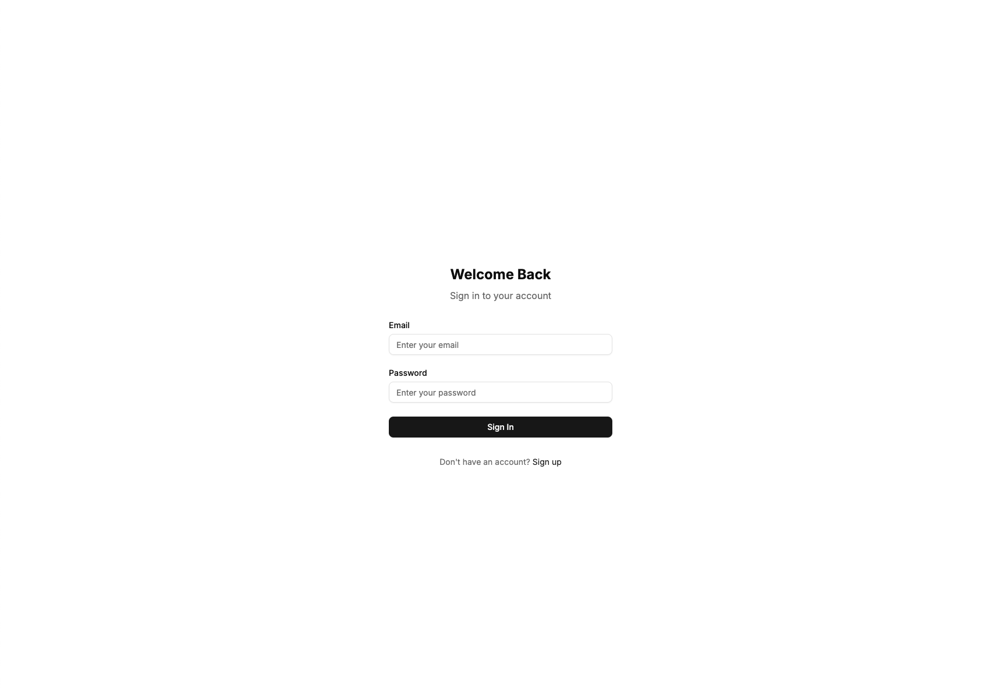
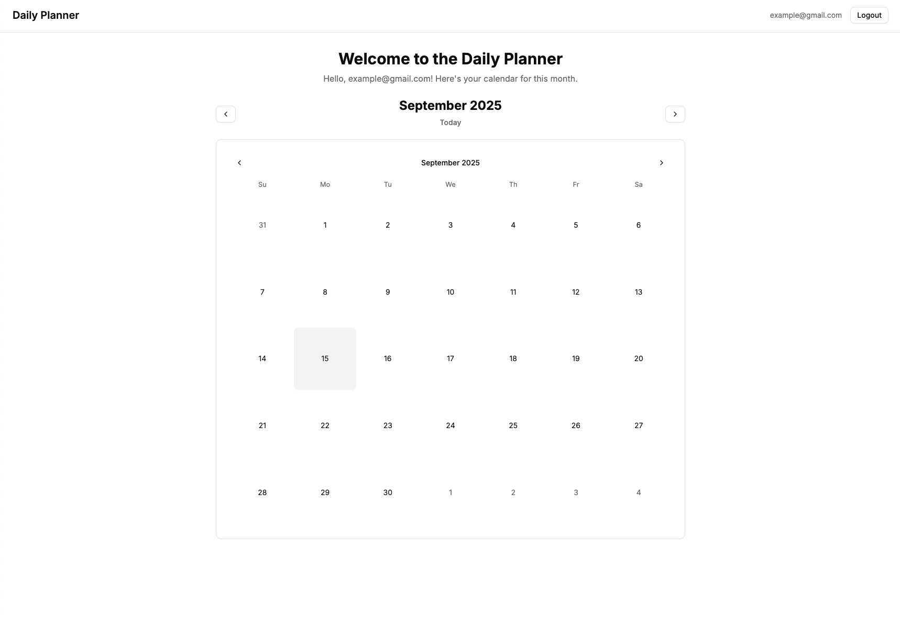
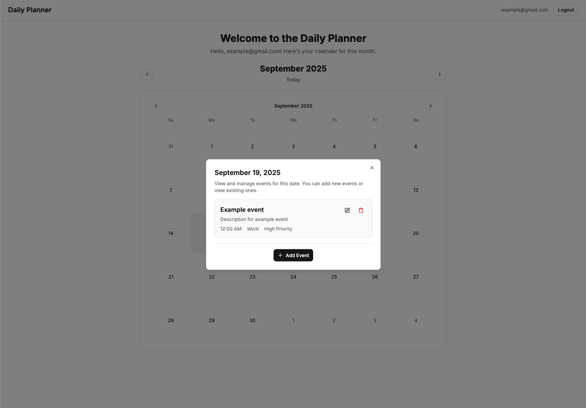
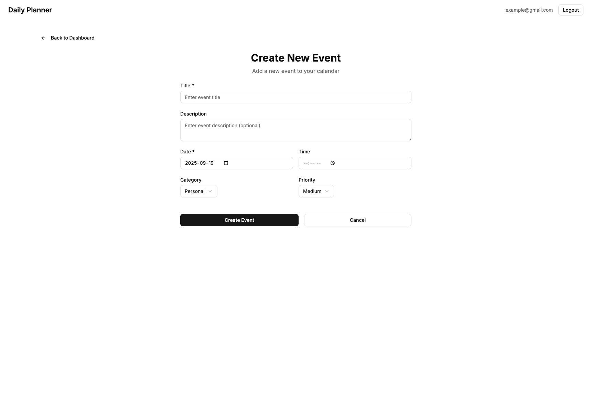
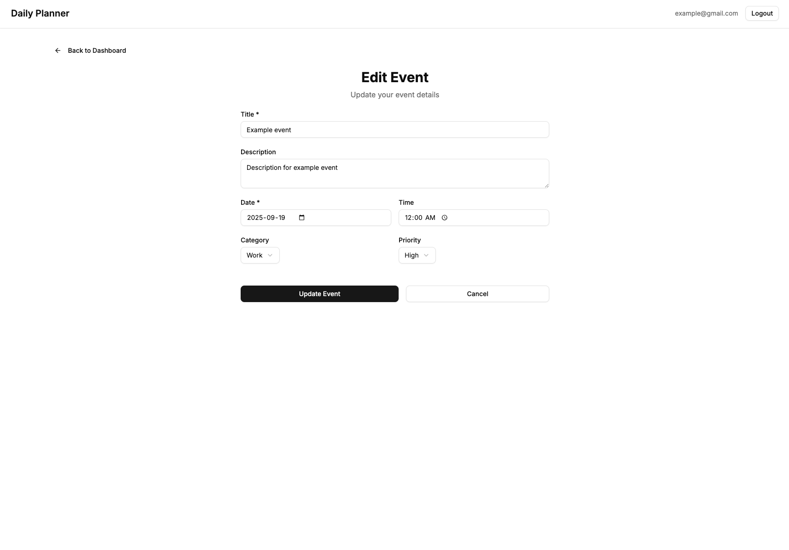
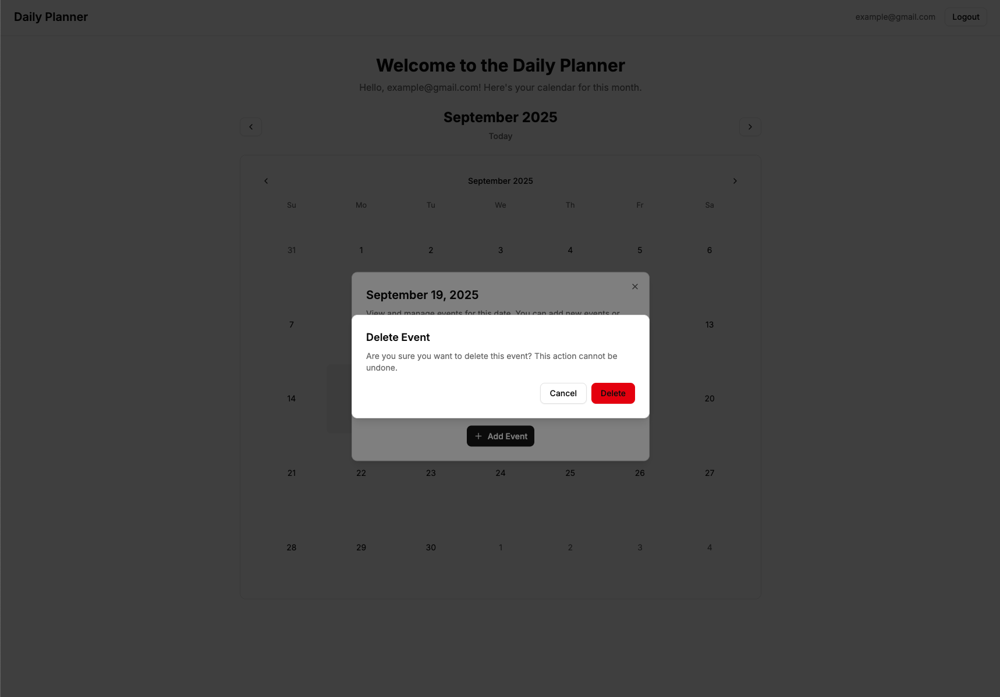

# Daily Planner Frontend

A modern, responsive React/Next.js frontend for a daily planner application, featuring authentication, calendar management, and comprehensive event CRUD operations.

## 🚀 Features

### 🔐 Authentication & User Management
- **Secure Login/Registration** - JWT-based authentication with form validation
- **Protected Routes** - Automatic redirection based on authentication status
- **Persistent Sessions** - Token storage in localStorage with automatic restoration
- **User State Management** - Zustand store for global authentication state

### 📅 Calendar & Event Management
- **Interactive Monthly Calendar** - Click-to-view daily events with visual indicators
- **Daily Agenda View** - Detailed event list for selected dates
- **Event CRUD Operations** - Create, read, update, and delete events
- **Event Editing** - In-place editing with pre-filled forms
- **Event Deletion** - Safe deletion with confirmation dialogs
- **Event Filtering** - Filter events by date, month, and year
- **Real-time Updates** - Automatic refresh of events after modifications

### 🎨 Modern UI/UX
- **Responsive Design** - Mobile-first approach with Tailwind CSS
- **Component Library** - Custom UI components built with Radix UI
- **Form Validation** - Client-side validation with error handling
- **Loading States** - User feedback during async operations
- **Accessibility** - ARIA-compliant components and keyboard navigation

### 📱 Event Features
- **Rich Event Data** - Title, description, date, time, category, and priority
- **Event Categories** - Work, Personal, Health, Other with visual indicators
- **Priority Levels** - Low, Medium, High priority classification
- **Date & Time Support** - Full date and time scheduling with native inputs
- **Quick Actions** - Edit and delete events directly from the agenda

## 📸 Screenshots

### Login/Registration

*User authentication pages with form validation*

### Dashboard & Calendar View

*Main dashboard showing the monthly calendar with event indicators*

### Daily Agenda

*Daily agenda view showing events for a selected date*

### Event Creation

*Event creation form with all fields and validation*

### Event Editing

*Event editing form with pre-filled data and update functionality*

### Event Deletion

*Event deletion confirmation dialog with safety measures*

## 🛠 Tech Stack

- **Next.js 15.5.0** - React framework with App Router
- **React 19.1.0** - UI library with latest features
- **TypeScript** - Type-safe development
- **Tailwind CSS 4** - Utility-first CSS framework
- **Radix UI** - Accessible component primitives
- **Zustand** - Lightweight state management
- **React Hook Form** - Form handling and validation
- **Zod** - Schema validation
- **Lucide React** - Icon library
- **Date-fns** - Date manipulation utilities

## 📋 Pages & Routes

### Public Routes
- `/` - Landing page with authentication redirect
- `/login` - User login page
- `/register` - User registration page

### Protected Routes
- `/dashboard` - Main calendar dashboard
- `/events/create` - Create new event
- `/events/[id]/edit` - Edit existing event
- `/events/[id]` - View event details

## 🎯 Key Components

### Layout Components
- `ProtectedLayout` - Wrapper for authenticated pages
- `Header` - Navigation and user menu
- `MonthlyCalendar` - Interactive calendar view
- `DailyAgenda` - Daily event management

### Form Components
- Event creation/editing forms
- Authentication forms
- Input validation and error handling

### UI Components
- Custom button, input, select, and dialog components
- Alert dialogs for confirmations
- Loading states and error messages

## 🚀 Getting Started

### Prerequisites
- Node.js 18+ 
- npm, yarn, pnpm, or bun
- Backend API running on `http://localhost:3001`

### Installation

1. **Clone the repository**
   ```bash
   git clone <repository-url>
   cd daily-planner-frontend
   ```

2. **Install dependencies**
   ```bash
   npm install
   # or
   yarn install
   # or
   pnpm install
   ```

3. **Set up environment variables**
   ```bash
   cp .env.example .env.local
   ```
   
   Add your environment variables:
   ```env
   NEXT_PUBLIC_API_URL=http://localhost:3001/api/v1
   ```

4. **Start the development server**
   ```bash
   npm run dev
   # or
   yarn dev
   # or
   pnpm dev
   ```

5. **Open your browser**
   Navigate to [http://localhost:3000](http://localhost:3000)

## 🔧 Available Scripts

- `npm run dev` - Start development server
- `npm run build` - Build for production
- `npm run start` - Start production server
- `npm run lint` - Run ESLint

## 📱 Responsive Design

The application is fully responsive and optimized for:
- **Desktop** - Full calendar view with sidebar
- **Tablet** - Adapted layout with touch-friendly interactions
- **Mobile** - Stacked layout with mobile-optimized forms

## 🔐 Authentication Flow

1. **Landing Page** - Redirects to login if not authenticated
2. **Login/Register** - JWT token storage in localStorage
3. **Dashboard** - Protected route with user context
4. **Auto-logout** - Token expiration handling

## 📊 State Management

### Auth Store (Zustand)
- User information and authentication status
- Token management and persistence
- Login/logout actions

### Events Hook
- Event data fetching and caching
- CRUD operations for events
- Loading and error states

## 🎨 Styling & Theming

- **Tailwind CSS** - Utility-first styling
- **Custom Components** - Reusable UI components
- **Dark/Light Mode** - System preference detection
- **Responsive Breakpoints** - Mobile-first design

## 🧪 Testing

```bash
# Run tests (when implemented)
npm run test

# Run linting
npm run lint
```

## 📦 Dependencies

### Core Dependencies
- `next` - React framework
- `react` - UI library
- `typescript` - Type safety
- `tailwindcss` - Styling

### UI & Forms
- `@radix-ui/*` - Component primitives
- `react-hook-form` - Form handling
- `zod` - Validation
- `lucide-react` - Icons

### State & Utils
- `zustand` - State management
- `date-fns` - Date utilities
- `clsx` - Class name utilities

## 🚀 Deployment

### Vercel (Recommended)
1. Connect your GitHub repository
2. Set environment variables
3. Deploy automatically on push

### Other Platforms
- **Netlify** - Static site hosting
- **Railway** - Full-stack deployment
- **Docker** - Containerized deployment

## 🔧 Configuration

### Environment Variables
```env
NEXT_PUBLIC_API_URL=http://localhost:3001/api/v1
```

### Tailwind Configuration
Custom theme and component styles in `tailwind.config.js`

## 📄 License

[Add your license information here]

---

Built with ❤️ using Next.js and React
